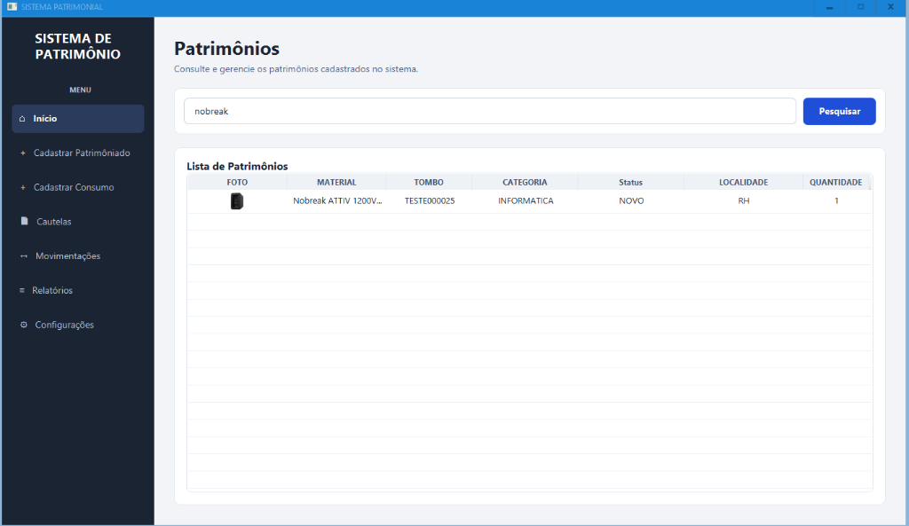
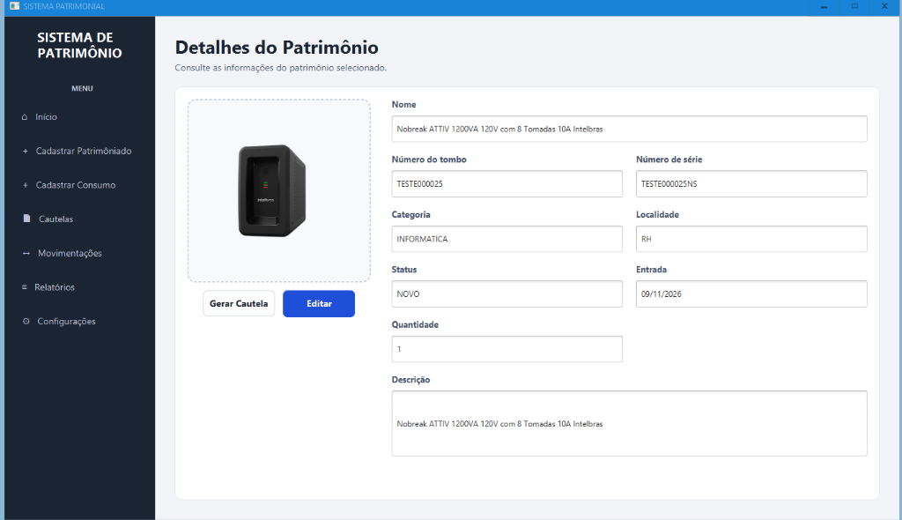
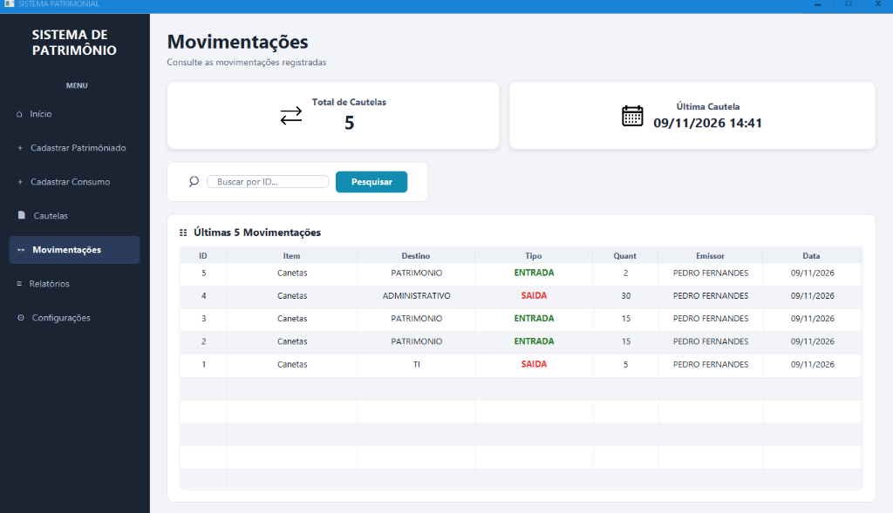

# 🏛️ Sistema Patrimonial

> **Gestão Integrada de Patrimônio, Almoxarifado e Cautelas**  
> Aplicação desktop desenvolvida em **Java 21** e **JavaFX**, com persistência em **MariaDB**, relatórios em **Excel (Apache POI)** e suíte de testes com **JUnit 5**.

---

## ⚡ Quick Start: Executar Demonstração (Sem Instalar Banco)

Para testar a aplicação imediatamente sem configurar servidor de banco de dados ou compilar o código:

> 📦 **Download do Pacote de Teste (`.zip`)**
> 
> O projeto disponibiliza um arquivo `.zip` com o **Fat JAR compilado** e uma base **H2 Database embutida** pronta com dados de exemplo.
>
> 1. Baixe e descompacte o arquivo `.zip` do projeto.
> 2. Com o **Java 21** instalado, abra o terminal na pasta descompactada e rode:
>    ```bash
>    java -jar Sistema-Patrimonial-1.0.0.jar
>    ```
> O sistema abrirá imediatamente conectado à base H2 de teste.

---

## 📸 Demonstração da Interface

| 🏷️ Consulta de Patrimônios | 🔍 Detalhes do Bem com Foto |
| :---: | :---: |
|  |  |

| 📦 Movimentações de Almoxarifado | 📝 Emissão e Histórico de Cautelas |
| :---: | :---: |
|  |  |

---

## 🚀 Principais Módulos

- **Gestão de Bens Patrimoniais:** Tombamento, controle de estado, localização física e suporte a fotos do item.
- **Controle de Almoxarifado (Consumo):** Entradas e saídas de itens com histórico e bloqueio contra saldo negativo.
- **Cautelas e Termos de Responsabilidade:** Empréstimo de bens com emissão de recibos e rastreio de devoluções.
- **Exportação de Relatórios:** Geração de relatórios gerenciais em planilhas `.xlsx` via Apache POI.
- **Regras de Negócio Testadas:** Cobertura de regras críticas via testes automatizados com JUnit 5.

---

## 🛠️ Stack Tecnológica

| Componente | Tecnologia |
|---|---|
| **Linguagem** | Java 21 LTS |
| **Interface Gráfica** | JavaFX 21 (FXML + CSS) |
| **Banco de Dados Principal** | MariaDB |
| **Banco de Dados para Testes** | H2 Database (embutido) |
| **Driver JDBC** | MariaDB Connector/J 3.3.3 |
| **Exportação de Relatórios** | Apache POI 5.5.1 (.xlsx) |
| **Testes Unitários** | JUnit 5 |
| **Build e Empacotamento** | Maven Wrapper + Maven Shade (Fat JAR) |

---

## ⚙️ Configuração para Desenvolvimento (MariaDB)

Caso queira rodar a partir do código-fonte ou com o MariaDB completo:

### 1. Banco de Dados
Crie a base no MariaDB e importe o esquema:
```sql
CREATE DATABASE sistema_patrimonial CHARACTER SET utf8mb4 COLLATE utf8mb4_unicode_ci;
```

Importe o arquivo `src/main/resources/database/esquema_tabelas.sql`:
```powershell
# Windows PowerShell
Get-Content -Raw "src/main/resources/database/esquema_tabelas.sql" | mariadb -u root -p sistema_patrimonial
```

### 2. Configuração de Acesso
Copie o template de propriedades:
```powershell
Copy-Item "src/main/resources/database/database.example.properties" "src/main/resources/database/database.properties"
```
Ajuste usuário e senha no `src/main/resources/database/database.properties`.

---

## 💻 Comandos Úteis (Maven Wrapper)

```bash
# Rodar testes automatizados
./mvnw.cmd test          # Windows
./mvnw test              # Linux/macOS

# Executar a aplicação em desenvolvimento
./mvnw.cmd clean javafx:run
./mvnw clean javafx:run

# Gerar o Fat JAR executável (na pasta target/)
./mvnw.cmd clean package
./mvnw clean package

# Executar o Fat JAR gerado
java -jar target/Sistema-Patrimonial-1.0.0.jar
```

---

## 📂 Visão Geral da Estrutura

- `src/main/java/sys/patrimonio/model/`: Entidades de domínio (Item, Cautela, Movimentação).
- `src/main/java/sys/patrimonio/repository/`: Camada DAO com queries JDBC.
- `src/main/java/sys/patrimonio/service/`: Regras de negócio e validações.
- `src/main/java/sys/patrimonio/view/`: Controllers JavaFX e launchers da aplicação.
- `src/main/resources/`: Arquivos FXML, estilos CSS e scripts SQL.
- `src/test/java/`: Testes de regras de negócio em JUnit 5.

---

## 📄 Licença

Distribuído sob licença MIT. Veja [`LICENSE`](LICENSE) para mais detalhes.
